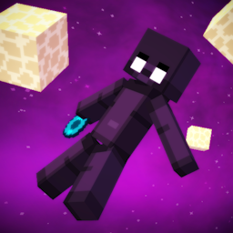

<div align="center">
  

  <h1>Endless Gravity</h1>

  <p>
    <a href="https://modrinth.com/mod/endless-gravity">
      
    </a>
    
    
    
  </p>

  <p>Low gravity for <b>The End</b> and layered atmosphere physics for the <b>Overworld</b>.</p>
</div>

## Features

- **The End**: reduced gravity for players, items, arrows, thrown projectiles, and falling blocks, configurable per entity type
- **Overworld atmosphere**: a continuous pressure curve (8 configurable layers) weakens gravity and muffles audio above Y 64, up to full vacuum at Y 3500
- **Fall damage**: normal or disabled in The End and Sable sub-levels, and no fall damage above a configurable altitude in the Overworld
- **Sable integration**: physics datapack (gravity, pressure, drag) generated automatically for The End and the Overworld, with configurable priorities
- **Modded config screen**: Cloth Config (bundled, no extra install) with *All*, *The End*, *Overworld*, and *General* tabs
- **Addon API**: stable `GravityApi` (query the gravity the mod would apply, register modifiers to change or cancel it) plus the `endless_gravity:gravity_immune` entity type tag
- **Compatible** with any modded dimension or Sable sub-level; config is synced from server to client on login

## Configuration

Open the mod settings from Mod Menu (or *Config → Endless Gravity*). Changes apply live where possible; the audio filter and Sable datapack need a restart.

### The End

| Setting | Default | Description |
|---|---|---|
| End Gravity | ON | Master toggle for low gravity in The End |
| Player Gravity Offset | 0.055 | Upward force per tick; 0.055 floats gently, crank it and you barely fall |
| Item Gravity Offset | 0.025 | Upward force per tick for items (they can't steer, keep it low) |
| Arrow Gravity Offset | 0.03 | Upward force per tick for arrows and tridents |
| Thrown Projectile Offset | 0.018 | Upward force per tick for snowballs, potions, pearls |
| Falling Block Offset | 0.035 | Upward force per tick for sand, gravel, anvils, dragon eggs |
| Fall Damage Mode | Disabled | Normal / Disabled (The End and Sable sub-levels; the Overworld stays vanilla) |
| Audio Filter Gain | 0.35 | Low-pass volume in The End; 1.0 is vanilla audio |
| Audio Filter Gain HF | 0.25 | High-frequency side of the filter |

### Overworld

| Setting | Default | Description |
|---|---|---|
| Enable Atmosphere | ON | Master toggle for Overworld space effects |
| Entity Gravity | ON | Gravity from the pressure curve applies to entities |
| Max Gravity Offset | 0.075 | Upward force at full vacuum (progress × max) |
| No Fall Damage Above | 400 | Above this Y, fall damage is cancelled (64–3500) |
| Muffle Gain | 0.01 | Low-pass gain at full vacuum, interpolated from 1.0 at ground |
| Muffle Gain HF | 0.005 | High-frequency part of the muffle |
| Atmosphere Layers | 8 layers | Altitude → pressure pairs: `-64:1.25, 64:1.0, 400:0.5, 900:0.2, 1200:0.08, 1800:0.01, 2500:0.001, 3500:0.0` |

## Addon API

The stable public API is `dinner.dev.endless_gravity.api.GravityApi`. Everything in the
`dinner.dev.endless_gravity.api` package is versioned by `GravityApi.API_VERSION`; classes outside it
(`EndlessGravityAPI`, config, mixins) are internal and may change without notice.

- `getGravityOffset(entity)`: the upward offset the mod would apply this tick (`0.0` if none), resolved through the exact same code path the mod itself uses
- `getGravityContext(entity)` / `channelFor(entity)`: the full calculation (source, offset, cancellation) and the entity's gravity channel (`PLAYER`, `MOB`, `ITEM`, `ARROW`, `THROWN`, `BLOCK`)
- `getPressure(y)`, `getAtmosphereProgress(y)`, `getAtmosphereOffset(y)`, `getRealY(entity)`: read the configured atmosphere curve and project positions out of Sable sub-levels
- `registerModifier(id, priority, modifier)`: run custom logic whenever an offset is resolved (the "calculate gravity" event); `ctx.setOffset`, `ctx.addOffset` and `ctx.cancel` control the result. Higher priority runs first, and a per-entity modifier (`setEntityModifier`) runs last
- `GRAVITY_IMMUNE` tag: add entity types to `data/endless_gravity/tags/entity_type/gravity_immune.json` to make them ignore reduced gravity

### Depending on the API

The artifact is on the Modrinth Maven as `maven.modrinth:endless-gravity` (`1.3.1` for NeoForge, `1.3.1-1.21.1-fabric` for Fabric); see the [Modrinth Maven docs](https://docs.modrinth.com/docs/tutorials/maven/) to add the repository. Declare it as a dependency (`"endless_gravity": ">=1.3.0"` in `fabric.mod.json`, or a `[[dependencies.mymod]]` entry with `versionRange = "[1.3.0,)"` in `neoforge.mods.toml`).

```java
GravityApi.registerModifier(ResourceLocation.fromNamespaceAndPath("mymod", "moon"), 0, ctx -> {
    if (ctx.level().dimension().location().toString().equals("mymod:moon")) {
        ctx.addOffset(0.02); // a little extra lift on top of the mod's own resolution
    }
});
```

All gameplay-affecting config values are synced from server to client on login via `ConfigSyncPayload`.

Some client-only settings are **not** synced and always come from your local config: atmospheric audio muffling, particle gravity, and custom dimensions (`config/endless_gravity/dimensions.json`). While connected to a remote server, the server's values are applied in memory for that session and your own values are restored on disconnect — synced values are never written to your config file.

## Loader differences

Both builds share the same config and behavior for The End and the Overworld. These are the only known gaps:

| Feature | NeoForge | Fabric |
|---|---|---|
| Create: Cosmonautics integration | Overworld gravity backs off when it is installed | Not supported |
| Sable sub-level physics and datapacks | Supported | Not supported |
| Custom dimensions — players | Reduced gravity applied | Not applied (mobs only) |

## Requirements

- Minecraft 1.21.1
- Fabric Loader 0.16.10+
- Cloth Config — bundled (via Jar-in-Jar), no manual install
- Create: Cosmonautics and Sable — **not supported on this build** (see *Loader differences*)

## License

[Apache 2.0](LICENSE)
