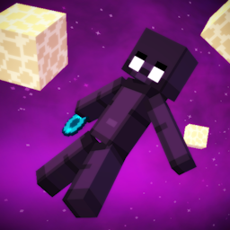

<div align="center">
  

  <h1>Endless Gravity</h1>

  <p>
    <a href="https://modrinth.com/mod/endless-gravity">
      
    </a>
    
    
    
  </p>

  <p>Low gravity for <b>The End</b> and layered atmosphere physics for the <b>Overworld</b>.</p>
</div>

## Features

- **Per-dimension profiles**: configure The End, the Overworld, and modded dimensions as either an atmosphere or fixed gravity, from the config screen or `config/endless_gravity/dimensions.json`
- **Fixed gravity**: separate offsets for players, mobs, items, arrows, thrown projectiles, and falling blocks
- **Atmosphere**: pressure layers, gravity ramp, audio muffling, and fall-damage altitude are configured per dimension; only players and mobs receive atmosphere gravity
- **Fall damage**: normal or disabled in The End and Sable sub-levels, and no fall damage above a configurable altitude in the Overworld
- **Sable integration**: physics datapack (gravity, pressure, drag) generated automatically for The End and the Overworld, with configurable priorities
- **Modded config screen**: Cloth Config (bundled, no extra install) with a single *Dimensions* editor and a *General* category; add and remove profiles by resource ID
- **Addon API**: stable `GravityApi` (query the gravity the mod would apply, register modifiers to change or cancel it) plus the `endless_gravity:gravity_immune` entity type tag
- **Compatible** with any modded dimension or Sable sub-level; config is synced from server to client on login

## Configuration

Open the mod settings from the NeoForge mod list (or *Config → Endless Gravity*). Changes apply live where possible; the audio filter and Sable datapack need a restart.

### Dimension profiles

The *Dimensions* editor includes **minecraft:overworld** and **minecraft:the_end** by default. All profiles appear in this one editor. To add one, enter its registered ID (for example `minecraft:the_nether` or `modid:moon`), choose a mode, optionally apply a preset, configure its values, then select **Add profile**. The editor only shows settings for the selected mode. Atmosphere layers can be adjusted by dragging points or entering altitude and pressure values; hover over the graph to read the curve and cursor values. Add and remove layers directly in the editor (at least two are required). You can continue adding or editing profiles without saving or leaving the screen; **Save** applies the changes. Removing a profile is reversible until save via **Undo**. Profiles can also be edited directly in `config/endless_gravity/dimensions.json`; removing one restores normal gravity in that dimension.

Atmosphere profiles can be saved as named presets in the editor. The *Custom atmosphere presets* section imports or exports presets as JSON text; export copies the JSON to the clipboard. The preset library is stored at `config/endless_gravity/atmosphere_presets.json`.

Each profile selects one mode:

| Mode | Settings | Entities affected |
|---|---|---|
| `atmosphere` | Start altitude, maximum gravity offset, pressure layers, audio gains, and `no_fall_damage_above` | Players and mobs |
| `fixed_gravity` | Independent offsets for players, mobs, items, arrows, thrown projectiles, and blocks | Each listed entity type |

The default Overworld profile uses atmosphere mode, starts gravity reduction at Y=319, reaches its maximum at the final pressure layer (Y=6000 by default), and cancels fall damage for falls starting above Y=4500. The End defaults to fixed gravity with the existing gentle offsets. A newly added dimension defaults to fixed gravity with zero offsets. Positive fixed offsets reduce gravity, negative offsets increase it, and zero keeps vanilla gravity. Set `no_fall_damage_above` to `null` (or `-1` in the menu) to keep vanilla fall damage at every altitude.

Example:

```json
{
  "dimensions": [
    {
      "id": "modid:moon",
      "mode": "fixed_gravity",
      "gravity": {
        "player": 0.04,
        "mob": 0.02,
        "item": 0.01,
        "arrow": 0.02,
        "thrown": 0.015,
        "block": 0.03
      },
      "atmosphere": {
        "start_altitude": 319,
        "gravity_offset": 0.075,
        "muffle_gain": 0.01,
        "muffle_gain_hf": 0.005,
        "layers": ["-64:1.25", "64:1.0", "400:0.5", "1200:0.4", "2000:0.3", "3000:0.2", "4500:0.1", "6000:0.0"]
      },
      "no_fall_damage_above": null
    }
  ]
}
```

In `fixed_gravity` mode, the atmosphere section is ignored; in `atmosphere` mode, the per-type fixed offsets are ignored. Legacy `dimensions.json` entries are read and migrated to the new profile model when saved.

The global fall-damage mode still controls The End and Sable, while the altitude threshold is per atmosphere profile (Sable keeps its global threshold). When the Overworld profile uses atmosphere mode, its gravity ramp and pressure curve also drive Sable's Overworld sub-level lift and datapack; Sable's own enable switches, drag, and fallback curve remain general settings.

## Addon API

The stable public API is `dinner.dev.endless_gravity.api.GravityApi`. Everything in the
`dinner.dev.endless_gravity.api` package is versioned by `GravityApi.API_VERSION`; classes outside it
(`EndlessGravityAPI`, config, mixins) are internal and may change without notice.

- `getGravityOffset(entity)`: the upward offset the mod would apply this tick (`0.0` if none), resolved through the exact same code path the mod itself uses
- `getGravityContext(entity)` / `channelFor(entity)`: the full calculation (source, offset, cancellation) and the entity's gravity channel (`PLAYER`, `MOB`, `ITEM`, `ARROW`, `THROWN`, `BLOCK`)
- `getPressure(y)`, `getAtmosphereProgress(y)`, `getAtmosphereOffset(y)`, `getRealY(entity)`: read the configured atmosphere curve and project positions out of Sable sub-levels
- `registerModifier(id, priority, modifier)`: run custom logic whenever an offset is resolved (the "calculate gravity" event); `ctx.setOffset`, `ctx.addOffset` and `ctx.cancel` control the result. Higher priority runs first, and a per-entity modifier (`setEntityModifier`) runs last
- `GRAVITY_IMMUNE` tag: add entity types to `data/endless_gravity/tags/entity_type/gravity_immune.json` to make them ignore reduced gravity

### Depending on the API

The artifact is on the Modrinth Maven as `maven.modrinth:endless-gravity` (`1.3.1` for NeoForge, `1.3.1-1.21.1-fabric` for Fabric); see the [Modrinth Maven docs](https://docs.modrinth.com/docs/tutorials/maven/) to add the repository. Declare it as a dependency (`"endless_gravity": ">=1.3.0"` in `fabric.mod.json`, or a `[[dependencies.mymod]]` entry with `versionRange = "[1.3.0,)"` in `neoforge.mods.toml`).

```java
GravityApi.registerModifier(ResourceLocation.fromNamespaceAndPath("mymod", "moon"), 0, ctx -> {
    if (ctx.level().dimension().location().toString().equals("mymod:moon")) {
        ctx.addOffset(0.02); // a little extra lift on top of the mod's own resolution
    }
});
```

All gameplay-affecting dimension profiles are synced from server to client on login via `ConfigSyncPayload`, along with the other gameplay config.

Some client-only settings are **not** synced and always come from your local config: the End audio filter, particle gravity, and Sable datapacks. While connected to a remote server, the server's values are applied in memory for that session and your own values are restored on disconnect — synced values are never written to your config files.

## Loader differences

Both builds share the same config and behavior for The End and the Overworld. These are the only known gaps:

| Feature | NeoForge | Fabric |
|---|---|---|
| Create: Cosmonautics integration | Overworld gravity backs off when it is installed | Not supported |
| Sable sub-level physics and datapacks | Supported | Not supported |
| Custom dimensions — players | Reduced gravity applied | Not applied (mobs only) |

## Requirements

- Minecraft 1.21.1
- NeoForge 21.1+
- Cloth Config — bundled (via Jar-in-Jar), no manual install
- Sable (optional — the mod runs without it; only the Sable sub-level physics and datapacks are skipped)
- Create: Cosmonautics (optional — when installed, it owns Overworld gravity and Endless Gravity backs off)

## License

[Apache 2.0](LICENSE)
